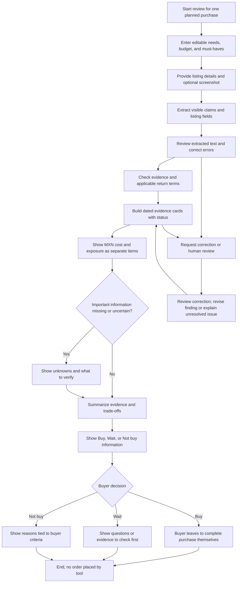
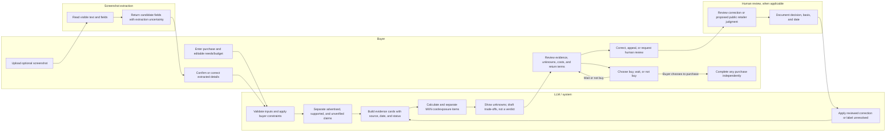

# Week 10 Project Packet: Pre-Checkout Regret Prevention

## 1. Problem and exact shopper persona

### The problem, in my words

Buying something online can be hard to undo. Before paying, shoppers may have to piece together whether a product suits their actual needs, whether the evidence supports the seller's claims, what the full cost will be in MXN, and what happens if they return it. Those details may be incomplete, unclear, or spread across screenshots and policy pages. This tool helps a buyer inspect one planned purchase, surface what is known and unknown, and decide whether to buy, wait, or not buy. It informs the buyer; the buyer makes the final decision, and the tool never places an order.

### Exact initial persona

A Mexico-based adult shopping online for one planned, non-emergency purchase in MXN who has a concrete budget and at least one personally important requirement (for example, size, compatibility, material, durability, or delivery timing). They can provide a product listing or screenshot and want to understand the evidence, total cost, and return exposure before paying. The MVP is for individual shoppers, not retailers, professional product reviewers, or a dispute-resolution authority. It is not designed to decide whether a merchant is safe or adjudicate whether a complaint is valid.

## 2. Measurable success

Before the module closes, at least 4 of 5 fictional, clearly labeled shopper-persona walkthroughs must correctly identify the product's advertised, supported, and unverified findings; explain the MXN total, delivery, exclusions, return costs, claim route, and any conditional financial exposure as separate items; find and use the correction/review route; and choose among buy, wait, or not buy without the tool placing an order or presenting unsupported protection, fit, rating, or merchant-safety claims.

This is a module acceptance target, not evidence of real-world consumer outcomes. Score each persona against the same checklist. Any missing source or term remains unknown; a walkthrough cannot pass by guessing or by treating generated demo data as real evidence.

## 3. Image-generated UI mockup

The supplied UI mockup is included at [docs/mockup.png](mockup.png). It is an illustrative screen, not evidence that any displayed merchant, product, price, review count/rating, return term, or review date has been checked. Treat all such visible details as fictional and unverified; do not reuse them as real findings or demo evidence.

The mockup shows a Spanish-language purchase review with optional screenshot input, buyer criteria, purchase summary, a return-policy warning, review information, unknown fit/sustainability information, and buy/wait actions. It does not yet show the required source/date/status on each evidence finding, nor all separate MXN cost, exclusions, claim-route, conditional-exposure, and correction/review details. Treat those as design gaps to address before implementation or user testing. The target screen must show editable buyer criteria; evidence cards with source/date and advertised/supported/unverified status; separate MXN line items for item total, delivery, exclusions, return costs, claim route, and conditional exposure; visible unknowns; and clear **Buy**, **Wait**, or **Not buy** information with buyer override. Include a prominent correction/review affordance. Avoid fake certainty, green safety scores, protected-purchase badges, sponsored recommendations, or imagery suggesting the system completes checkout.

## 4. User journeys

### Buyer flowchart

### Swimlane: buyer, LLM/system, screenshot extraction, and human review

Screenshot extraction provides candidate text, not truth. A human review is required before any consequential public judgment about a retailer; the MVP does not publish retailer rankings or adjudicate complaints. An unresolved or unsupported correction remains visibly unresolved rather than being silently accepted or rejected.

## 5. Benchmarks: mechanisms to investigate, not verified product claims

The following are reference points for design research. This packet does not claim to have audited their current features, terms, coverage, or performance. Before borrowing a mechanism, check current primary-source materials and document what is actually available.

| Benchmark | Mechanism inspiration to investigate | Boundary for this project |
|---|---|---|
| AskCR | A possible reference for consumer-facing purchase or product information and question-led decision support. Confirm its current scope and actual evidence mechanisms before relying on it. | Do not present AskCR functionality, coverage, or outcomes as verified by this packet. This tool is scoped to pre-checkout inspection of one planned purchase against the individual buyer's criteria, with unknowns kept explicit. |
| Which? | Possible inspiration for making product evidence and comparison understandable to consumers. Verify current methodology, access, and market coverage from primary sources. | Do not imply this tool has equivalent testing, expert review, ratings, or product coverage. No product score is generated merely because a listing or screenshot was supplied. |
| PROFECO | Mexico-specific reference for consumer-protection context, official guidance, and the need to distinguish consumer information from formal rights or processes. Verify current official guidance and applicable terms for each use. | The tool is not PROFECO, does not provide legal determinations, and does not promise that a consumer protection or remedy applies. Show a claim route only when supported by an attributable source; otherwise mark it unknown. |
| True Fit / Zalando | Possible mechanism inspiration for relating product attributes to a shopper's stated fit needs. Verify current functionality, data requirements, and market availability. | No guaranteed fit, body inference, or fit score in the MVP. A buyer can specify criteria, and any product fit information is labeled advertised, supported, or unverified. |
| Trusted Shops / BBB | Possible references for consumer-facing trust information, complaint pathways, or business profile mechanisms. Verify present scope, evidence rules, geographic coverage, and what each status means. | No merchant safety score, blanket trust badge, complaint adjudication, or public retailer judgment from unreviewed user or model content. Human review and a visible correction/appeal route precede any consequential public judgment; public judgments are outside MVP. |

These comparisons identify questions to research, not endorsements or findings about the named organizations. No benchmark affiliation, data access, or partnership is implied.

## 6. Three-year vision

In three years, the tool helps shoppers in Mexico inspect a planned purchase against their own needs, budget, and the best attributable evidence available before they pay. Its dated evidence cards make it easy to distinguish what a seller advertises, what a source supports, and what remains unknown, while explaining full MXN cost and conditional return exposure without promising an outcome. Buyers retain control, can correct or appeal consequential findings, and can choose to buy, wait, or walk away without the tool ever ordering for them.

## 7. Strict MVP scope

### In scope

- A small, Spanish-first responsive experience for reviewing one planned purchase at a time.
- Buyer-entered, editable needs, budget, must-haves, and purchase details.
- Optional screenshot input and extraction of candidate visible listing fields, with uncertainty shown and buyer correction required before consequential use.
- A small, manually reviewed set of product/evidence examples, clearly labeled as synthetic in demos. Any real-world finding requires a named, dated, linkable source and a defined advertised/supported/unverified status.
- Dated evidence cards that show source, date, and status. Missing evidence stays **unknown**; the model cannot fill gaps with plausible-sounding facts.
- An itemized display in MXN that separately presents:
  - item price and calculated total;
  - delivery;
  - exclusions, taxes, or fees when applicable and supported;
  - return costs;
  - the source-supported claim route, if known; and
  - conditional financial exposure, with the condition and uncertainty stated.
- Return terms shown as quoted/source-supported information with source and date, not as a guarantee of protection. If the term or route cannot be verified, show unknown.
- A transparent summary of trade-offs and **Buy**, **Wait**, or **Not buy** information tied to the buyer's own criteria. All criteria are editable; the buyer can override the recommendation and remains the decision-maker.
- A correction/review route with visible status. Require human review before consequential public judgments about a retailer. Do not publish public retailer judgments in this MVP.
- Fictional, clearly labeled data for demos and persona tests.

### Explicitly out of scope

- Checkout automation, order placement, payment processing, or automated cart modification.
- Retailer certification, audits, badges, or declarations that a merchant is safe.
- Sponsored rankings, paid placement, affiliate links, referral commissions, or payments for favorable findings.
- Product rankings, unsupported ratings, guaranteed fit, or verified merchant/product scores without qualifying evidence and methodology.
- Full complaint adjudication, legal advice, enforcement decisions, or promises of a refund or remedy.
- Public retailer judgments or complaint summaries in the MVP.
- Broad web scraping, real-time catalog coverage, or claims that the product represents all Mexican merchants, policies, or consumer rights.
- Persistent user profiles or collection of identity, payment-card, account-login, or precise location data.

## 8. Architecture and free-stack plan

Keep the prototype small: one review flow, one server-side LLM integration, optional screenshot extraction, a limited evidence-record format, and no persistent personal-data store. Compute arithmetic deterministically; use the LLM to organize and explain validated information, not to establish facts or decide for the buyer.

| Component / DRAGON STACK element | Concrete MVP implementation | Free-stack approach and guardrails |
|---|---|---|
| Web app | Next.js + TypeScript, deployed to Vercel with a preview deployment and a production deployment. One review route and small reusable components. | Use a free/Hobby tier only if current eligibility and limits allow; confirm at implementation time. No setup is performed as part of this packet. |
| LLM | Server-side Google Gemini API adapter for structured extraction cleanup and plain-language trade-off summaries. Validate schema, field provenance, and output length; do not let the model create sources, costs, terms, scores, or recommendations unsupported by input. | Use a free quota only if currently available and terms are appropriate. Check retention/training settings before any real buyer data is sent. Provider or quota failure produces an explicit unavailable state, not a fabricated completion. |
| Buyer-provided constraints | Buyer-entered needs, budget, must-haves, and purchase-specific facts held in ephemeral browser state and sent only as needed to the server. | No account or database for the MVP. Avoid personal identifiers; provide clear/reset controls. If future scope stores personal data, require authentication, access controls, retention/deletion rules, and a privacy review first. |
| Screenshot vision: extraction | Browser upload to a constrained server endpoint; use an available vision-capable model/API to extract candidate visible text and fields, returning field-level confidence/uncertainty and source location (image region where practical). Buyer confirms or corrects extracted fields. | Evaluate free-tier availability and image-data terms before choosing a provider. Limit image size/type and retention; do not store the original screenshot after the review. Never treat OCR/vision output as verified evidence. |
| Dated evidence cards | Small typed records: claim, source name/URL, retrieval or publication date, geographic/applicability note, status (advertised/supported/unverified), and reviewer note. Attach provenance to each finding, not merely to the overall summary. | Start with a deliberately small, manually checked evidence set and labeled synthetic fixtures. No general web crawler. A missing field or source means unknown. Recheck before each deployment if demonstrating real evidence. |
| MXN costs and exposure | Deterministic arithmetic over buyer-entered or source-supported line items; show item price, delivery, exclusions, return cost, claim route, and conditional exposure separately with units and assumptions. | Unit-test calculations, rounding, missing values, and conditions. Do not infer fees or legal protection from generated text. |
| Correction and review | Per-card “report/correct this” form that records the disputed field, reason, date, and status in the current session; human reviewer checks corrections and documents outcome before any consequential public retailer judgment. | Keep corrections local to the demo/session in the MVP; no public retailer judgment is issued. If public judgments are ever introduced, require authenticated reviewer access, audit trail, evidence standards, appeal/correction process, and abuse controls first. |
| Mechanical quality checks | Type-check, lint, unit tests for validation, calculations, provenance labels, unknown states, and correction status; production build. | Use project-standard tooling once an app exists. No packages, APIs, or deployments are configured by this documentation task. |

**Data flow:** buyer constraints and listing details → validated inputs → optional screenshot candidate extraction → buyer correction/confirmation → source-linked evidence records → deterministic MXN calculations → constrained LLM explanation → buyer review and optional correction request. Human review is a gate for consequential public retailer judgments; the MVP makes none. The system never navigates checkout or submits an order.

“Free” means a proposed no-cost-to-start implementation if current provider and hosting terms permit it; it does not promise permanent free hosting, unlimited model use, or free access to external evidence. Verify quotas, terms, retention, and privacy settings before enabling each provider.

## 9. Test plan and acceptance criteria

### Test plan

1. **Mechanical bug testing**
   - Run type-check, lint, unit tests, and production build.
   - Test invalid, missing, oversized, and malformed buyer inputs and image files; confirm safe validation errors.
   - Test deterministic MXN calculations for delivery, exclusions, return costs, and conditional exposure, including missing values and rounding.
   - Test evidence-card rendering for source/date/status combinations; missing source or date must remain unknown, never silently become supported.
   - Test that vision/LLM errors, malformed outputs, and unknown claims fail closed with a visible error/unknown state.
   - Test that every displayed buyer criterion is editable and the buyer can override Buy/Wait/Not buy information.
   - Test correction submission, visible status, reviewer resolution, and appeal/correction path; no consequential public judgment can appear without human review.
   - Test clear/reset behavior, keyboard navigation, accessible labels, and mobile layout.
2. **Fix and redeploy**
   - Fix all release-blocking defects found in mechanical tests.
   - Deploy a preview, repeat the relevant mechanical checks against it, and verify that client assets contain no secrets.
   - After fixes and acceptance pass, deploy production as the second deployment and repeat smoke tests. If a deployment check fails, fix and redeploy before calling the release complete.
3. **Fictional persona walkthrough and comprehension checks**
   - Use at least five fictional personas with prominently labeled synthetic data: a strict-budget buyer; a buyer with a fit/compatibility must-have; a buyer whose screenshot extraction is wrong; a buyer with missing return terms; and a buyer whose product evidence conflicts or is stale.
   - Walk each persona through the complete flow, including correction, override, and buy/wait/not-buy choices. Record failures; do not count a guessed answer or a fabricated source as a pass.
   - Ask each persona (or test participant acting from the persona script) to explain in their own words: what is advertised vs supported vs unknown, the MXN amount and its components, what return costs/exposure are conditional, and what the tool does not guarantee.
   - Retest after any correction to product behavior or copy. Do not use synthetic walkthroughs as evidence of real market demand or real consumer outcomes.

### Acceptance criteria

- At least 4 of 5 fictional persona walkthroughs pass every applicable checklist item before the module closes; the missing-return-terms and incorrect-extraction personas must be included in the denominator.
- Every evidence finding displays source, date, and advertised/supported/unverified status. Missing or stale evidence is marked unknown or stale, not inferred as support.
- MXN total, delivery, exclusions, return costs, claim route, and conditional financial exposure are displayed as separate fields; unknown items are visibly unknown and conditional amounts state their assumptions.
- No generated return protection, guaranteed fit, verified rating, or merchant safety score is shown.
- Buyer criteria are editable; the interface presents useful wait/not-buy information and permits override. It never places an order or automates checkout.
- A visible correction/review route exists. Any consequential public retailer judgment is blocked pending human review; no public retailer judgment is included in the MVP.
- No affiliate links, sponsored rankings, or payments for favorable findings exist in the design or demo.
- Demo data and personas are fictional and visibly labeled. No unsupported real-world research or verification is claimed.
- Mechanical checks pass, defects are fixed and retested, preview and production deployments are exercised, and persona comprehension checks are recorded.

## 10. Mandatory security and privacy floor

- Collect only purchase details and buyer constraints needed for the current review. Do not request names, account credentials, payment details, identity documents, or precise home address.
- Use fictional, clearly labeled data in demos, screenshots, fixtures, and persona walkthroughs. Do not present synthetic listings, policies, sources, ratings, or prices as real.
- Validate and bound text inputs, image file types and sizes, model outputs, source URLs, and all rendered fields. Escape displayed content; never execute generated markup, scripts, URLs, or code.
- Keep all provider credentials server-side in deployment secrets. Never place keys in browser code, public environment variables, URLs, logs, or error messages.
- Do not persist buyer data or original screenshots in the MVP; avoid logging raw listing text, screenshots, prompts, or buyer narratives. Provide visible session reset/clear behavior.
- If future work stores personal data, require authenticated access, role-appropriate access controls, retention/deletion controls, and a privacy/security review before implementation.
- Use HTTPS; apply request-size limits and abuse/rate controls appropriate to the hosting tier; return safe, explicit errors without exposing internals.
- Do not fetch arbitrary model-provided URLs server-side. Restrict evidence links to validated HTTP(S) URLs and render them as links for buyer inspection.
- Review model/image provider terms, retention, and training settings before sending any non-fictional buyer content. If terms or protections are unsuitable or unclear, do not send that data.
- Keep buyer override meaningful: no dark patterns, forced purchase decisions, checkout action, sponsored placement, or paid influence on findings.
- Human review, documented basis, and a visible correction/appeal route are mandatory before any consequential public retailer judgment; no such public judgments are in MVP scope.

## Delivery plan: five small commits and two planned deployments

This is a future implementation sequence, not authorization to build, deploy, or commit now.

1. **Scaffold and preview deploy:** minimal Next.js/TypeScript shell, quality commands, preview deployment; verify no secrets in client output.
2. **Buyer intake and constraints:** one-purchase flow, editable criteria, ephemeral state, validation, and reset; add input tests.
3. **Screenshot extraction and evidence cards:** candidate extraction with buyer confirmation, dated source/status records, unknown states, and correction route; use labeled synthetic fixtures.
4. **Costs and constrained explanation:** deterministic MXN breakdown and server-side LLM summary with strict validation, explicit errors, and no automated action.
5. **Test, fix, and release:** run mechanical checks, five fictional persona walkthroughs and comprehension checks; fix defects and retest on preview; complete privacy/security and evidence checks, then deploy production and smoke-test.

Keep each commit small and reviewable. The two planned Vercel deployments are preview and production; if a deployment check fails, fix and redeploy as needed rather than release a failing build. Do not deploy as part of this packet task.
